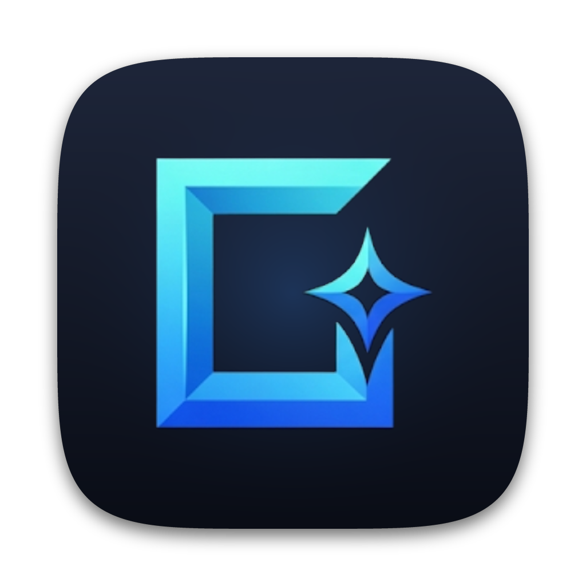

<div align="center">



# Glint : Caelix IDE

**A liquid-glass code editor with built-in AI, live collaboration and developer workflow tools.**


[Quick start](#quick-start) · [Features](#feature-sets) · [Shortcuts](#keyboard-shortcuts) · [Architecture](#architecture) · [Development](#development)

</div>

---

## Overview

Glint is a VS Code-inspired editor on an Electron shell. **Glint** is the editor; **Caelix** is the platform it runs on, the same relationship as Google's Antigravity and Antigravity IDE. This repository is the IDE build.

| | |
|---|---|
| **Liquid glass UI** | Translucent, blurred surfaces that tint with your desktop. Liquid mode refracts your actual wallpaper behind the editor. |
| **Fully personalisable** | Accent, background, foreground, glass blur and opacity, plus full typography control and custom font import. |
| **AI-first** | 14 providers, objective-based routing with OmniRoute, inline ghost text, explain / refactor / docstrings / commit messages. |
| **Local-first** | Every file operation runs on your machine. Nothing is uploaded unless you explicitly deploy. |

## Quick start

```bash
git clone https://github.com/mailsitnc-ai/glint.git
cd glint
npm install
npm start
```

Requires Node.js 18+ and macOS (Apple Silicon or Intel). To get AI working with no setup, pick **Pollinations.ai** or an `-free` model on **OpenCode Zen**; no API key needed.

### Build the app

```bash
npm run pack       # unpacked app  -> dist/mac-arm64/Glint.app
npm run dmg        # build + create dist/Glint-<version>-arm64.dmg (drag-to-Applications)
```

> **Opening an unsigned build:** macOS Gatekeeper blocks apps that aren't signed with an Apple Developer ID. Right-click `Glint.app` -> **Open** the first time, or run `xattr -cr Glint.app`.

## Keyboard shortcuts

| Action | Shortcut |
|---|---|
| Open folder | `⌘O` |
| Open file | `⇧⌘O` |
| Save / Save as | `⌘S` / `⇧⌘S` |
| Command palette | `⇧⌘P` |
| Find / Replace | `⌘F` / `⇧⌘F` |
| Toggle sidebar | `⌘B` |
| Toggle terminal panel | `⌘J` |
| Zen mode | `⌘K` |
| Liquid mode | `⌘⌥L` |
| Settings | `⇧⌘K` |
| New window | `⇧⌘N` |

---

## Feature sets

### Liquid glass

The glass is a real material, not a flat translucent fill. Three layers do the work:

**1. Backdrop** (`src/renderer/styles/base.css`, `#root::before` / `#root::after`)
Five radial gradients — keyed to the accent colour so the mesh follows the
theme — over a diagonal base gradient, plus a screen-blend bloom for light
falloff and a fine SVG-turbulence grain that stops banding. This layer is
essential: without something colourful behind it, `backdrop-filter` has
nothing to refract and every panel renders flat.

**2. Material** (`.glass`, `.chrome-glass`)
Surfaces are a translucent white tint *over* the backdrop rather than a flat
tint of the background colour. The blur is `blur(30px) saturate(200%)
brightness(118%)`. Edges are a gradient drawn with a masked pseudo-element —
bright specular at the top fading to an accent-tinted chromatic edge at the
base — finished with an inset bevel highlight and an outer shadow.

**3. Application**
Title bar, activity bar, sidebar, tab bar, status bar, editor pane, gutter,
find bar, bottom panel, side panels, command palette, modals, buttons, icon
buttons, tree items, chat bubbles, provider cards and inputs.

Measured before this change, one colour occupied 69% of the frame. After, no
colour exceeds 4% and each panel shows its own gradient as the accent
refracts through it.

Modes:
- **Solid** (`no-glass`) keeps a dimmed backdrop and flattens the translucency
- **Liquid** layers the desktop wallpaper over the mesh rather than replacing it
- **Ambient light** shifts a tint across the day

`npm run test:glass` asserts all of the above (31 assertions) directly
against the computed styles.

### Performance
- **Virtual scrolling** — only the visible window of lines is rendered for huge files (configurable threshold, default 5000 lines). Verified with 12,000-line files.
- **Native file watching** — event-driven `fs.watch` with debounced notifications instead of polling.
- **Non-blocking typing** — all heavy work (AI requests, analysis, git, deploys) runs in the main process or off the UI thread.
- **Lazy startup** — no extension host to warm up.

### AI-first

**14 providers**, all speaking the OpenAI-compatible chat-completions wire format.

| Provider | Key | Notes |
|----------|-----|-------|
| **Kilo Code Gateway** | optional | 470 models, 9 free, 200 req/hr anonymous, **FIM completions** for ghost text |
| **Pollinations.ai** | optional | Zero setup, works with no key. 1 request / 45s anonymous |
| **OpenCode Zen** | optional | 105 models, `-free` models work with no key |
| **CoArena** | optional | 20 frontier models. Model list is public; chatting needs a key |
| **OpenRouter** | required | 1,000 free-model requests/day, `openrouter/free` router model |
| **NVIDIA NIM** | required | 33 models incl. Kimi K3.1 Pro, Mistral Large |
| **DeepInfra** | required | 178 open models |
| **Groq** | required | Lowest latency — ideal for inline completions |
| **Google Gemini** | required | Very large context windows, generous free tier |
| **Numes** | required | Additional OpenAI-compatible provider |
| **Abliteration AI** | required | Relaxed content policies |
| **OmniRoute** | optional | **Routes across your connected providers by objective** |
| **Local** | none | Ollama, LM Studio, llama.cpp — nothing leaves your machine |
| **Custom** | optional | Any OpenAI-compatible endpoint |

**Features**
- **Chat panel** with file context attachment and conversation history
- **Inline ghost text** completions while typing (rate-limited so typing stays smooth)
- **AI explain**, **AI refactor** (with a stated goal), **AI docstring generation**
- **AI commit messages** generated from your actual git diff
- **Local fallback** docstring generator that works with no provider configured

### OmniRoute
Routes a request across every provider you have connected, picking models by objective and falling back automatically when one fails.

| Objective | Prefers |
|-----------|---------|
| `auto` | Balanced quality and speed |
| `auto/coding` | Code-specialised models (Qwen Coder, Codestral, Devstral) |
| `auto/smart` | The strongest reasoning models |
| `auto/fast` | Lowest-latency models (Groq gets a bonus) |
| `auto/cheap` | Free and inexpensive models |

A self-hosted OmniRoute server can be used as the primary route, with the connected providers kept as fallbacks.

### Model archive
Any model can be archived to hide it from the pickers and exclude it from routing. Archived models persist across restarts and can be restored individually or all at once from the **Archived** section in the AI sidebar.

### Collaboration
Zero runtime dependencies — Glint ships its own RFC6455 WebSocket client/server.
- **Built-in relay server** so teammates connect over your LAN (or a tunnel)
- **Operation-based edit sync** with sequence numbers and deduplication
- **Live peer cursors** with per-user colours and name flags
- **Session chat** and a session URL you can copy and share

### UI / UX
- **Liquid mode** — refracts your desktop wallpaper behind translucent surfaces
- **Ambient light** — tint follows the time of day (dawn → day → dusk → night)
- **Theme marketplace** — 10 built-in themes plus custom theme export/import
- **Per-project themes** via `.glint/settings.json`
- **Zen mode** — hide all chrome and focus on code

### Intelligence
- **Semantic-ish search** across the project with relevance scoring and symbol bonuses
- **Dead-code detection** by cross-referencing definitions and usages
- **Test impact analysis** mapping source files to the tests that touch them
- **Project overview** statistics (files, lines, languages, dead code, test coverage)

### Developer workflow
- **Live preview** with auto-detected dev server (Vite, Next, Nuxt, CRA, static, Python)
- **Deploy targets** — Vercel, Netlify, Cloudflare Pages, GitHub Pages, or local export
- **Database browser** — SQLite files and HTTP JSON endpoints
- **Embedded API client** — methods, headers, body, formatted response viewer, request history
- **Terminal panel** for running commands in the workspace

### Typography
- Font family (system monospace fonts plus custom imports)
- Font size, weight, line height, letter spacing
- Font ligatures toggle
- Import `.ttf` / `.otf` fonts directly from your Mac

---

## Core editing (verified end-to-end)

| Area | What works |
|------|------------|
| Workspace | Open folder / open file, recursive explorer with collapsible folders, file sizes, recent folders |
| Editor | Tabs with dirty indicators, save (⌘S), save as (⇧⌘S), close with unsaved-change prompt |
| Code presentation | Line numbers with active-line highlight, current-line highlight, syntax highlighting, language detection |
| Navigation | Command palette (⇧⌘P), find (⌘F), replace (⇧⌘F), sidebar toggle (⌘B), bottom panel (⌘J) |
| Appearance | Colour customisation, glass blur/opacity sliders, 10 themes, ambient light, liquid mode |
| Integration | Menu bar (File/Edit/View/AI/Collab/Theme/Tools/Window/Help), window controls, external file-change detection |
| Status | Encoding, indent width, cursor position, language, active theme, live-collab indicator |

---

## Architecture

```
src/
  main/
    main.js                    Electron entry: window, menu, IPC wiring
    services/
      settings.js              Global + per-workspace settings store
      workspace.js             Tree building, file I/O, native fs.watch
      ai.js                    Provider abstraction + per-provider calls
      providers.js             Provider registry (14 providers, objectives)
      archive.js               Model archive with persistence
      omniroute.js             Objective-based routing across providers
      collaboration.js         Operation-based sync, peer/cursor/chat state
      relay.js                 In-process collaboration relay server
      websocket.js             RFC6455 WebSocket client/server (no deps)
      intelligence.js          Search, dead code, test impact, docstrings
      workflow.js              Preview, deploy, database, API client, terminal
      themes.js                Built-in themes, marketplace, wallpaper, fonts
      git.js                   Status, diff, stage, commit, log
  preload/
    preload.js                 contextBridge API — the only renderer↔main channel
  renderer/
    index.html                 UI structure
    styles/
      base.css                 Design system, layout, editor, activity bar
      panels.css               AI chat, settings, marketplace, dialogs, panels
    modules/
      editor.js                EditorEngine: virtual scrolling, highlighting, tabs
      themes.js                ThemeManager: appearance, fonts, marketplace, liquid mode
      ai.js                    AI chat, ghost text, refactor, commit messages
      collaboration.js         Session lifecycle, remote cursors, chat
      intelligence.js          Search, dead code, test impact, overview
      workflow.js              Preview, deploy, database, API client, terminal
    renderer.js                Entry point wiring everything together
```

The renderer runs sandboxed with `contextIsolation: true` and `nodeIntegration: false`. Every privileged operation goes through the explicit API exposed by the preload script. All heavy computation lives in the main process.

---

## Development

```bash
npm install
npm start          # run in development
npm run pack       # package to dist/mac-arm64/Glint.app
```

The app icon lives in `assets/` (`icon.png`, `icon.icns`); the titlebar logo is `src/renderer/assets/logo.png`.

## Testing

End-to-end tests drive the running app through the Chromium DevTools
Protocol — real renderer, real IPC, real filesystem. See [`test/README.md`](test/README.md).

```bash
npm run pack
./dist/mac-arm64/Glint.app/Contents/MacOS/Glint --remote-debugging-port=9333 &
npm test
```

## Verification

- **65 end-to-end assertions** across the rebrand, provider registry, keyless live model lists, key guards, archive/restore/persistence, OmniRoute objectives, candidate ranking, live routing and the full UI — run against the packaged app.
- **43/43 keyed-provider assertions** verifying each provider's request shape, auth headers and response parsing against a mock OpenAI-compatible server.
- **47/47 core feature assertions** covering the editor, fonts, colours, performance settings, marketplace, semantic search, dead code, test impact, collaboration, API client, deploy, database, terminal, zen/liquid mode and git.
- Syntax checks pass on all main-process and renderer modules.
- Renderer boots with no console errors.

## Security notes

- `contextIsolation` enabled, `nodeIntegration` disabled.
- Narrow, explicit preload API surface.
- All IPC channels in `main.js` have matching handlers in `preload.js`.
- AI provider credentials are stored locally and only sent to the endpoint you configure.

## License

MIT
